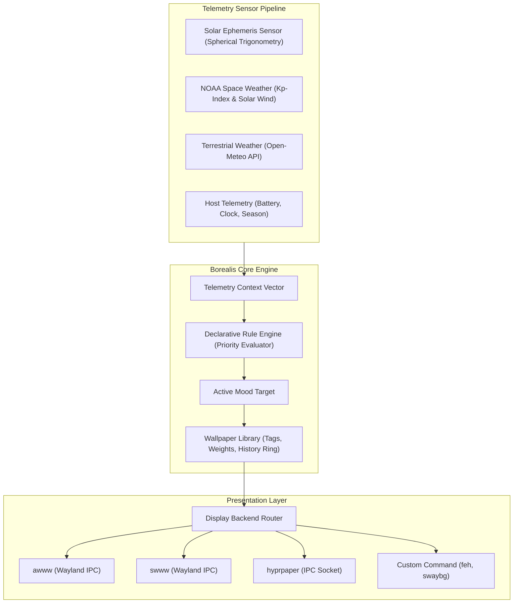

# Architecture & Foundations

Borealis is designed as an autonomous, telemetry-driven environment synthesizer. It couples real-time geophysical telemetry streams with desktop compositor presentation layers.

---

## Why "Borealis"? (The Lore)

> **aurora borealis** (`/ˌbɔː.riˈæl.ɪs/`) — *noun:* The luminous celestial curtain of green, violet, and crimson ribbons that dances across high-latitude polar skies, sparked by solar wind colliding with Earth's magnetosphere.

The polar night is never static; its sky pulses with the rhythmic ebb and flow of space weather, geomagnetic storms, and the silent turn of the planetary axis.

**Borealis mirrors the living polar sky on your desktop:**
- **Telemetry-Driven Ambiance**: Continuously synchronizes Wayland desktop wallpapers with live geomagnetic disturbance indices (Kp), solar wind velocity, and local solar ephemerides.
- **Autonomous Transitions**: Shifts smoothly between daylight radiance, twilight gradients, and dancing auroral displays without abrupt background flashes or heavy GPU overhead.

---

## System Architecture

---

## Telemetry Sensing Pipeline

### 1. Astronomical Mechanics & Solar Phases

Borealis calculates local solar positioning on-the-fly without heavy dependencies:
- **Solar Declination ($\delta$)**: Derived from Julian date orbital offsets.
- **Hour Angle ($H$)**: Computed from local solar time and longitude coordinates.
- **Solar Elevation Angle ($\alpha$)**:
  $$\sin \alpha = \sin \phi \sin \delta + \cos \phi \cos \delta \cos H$$
  where $\phi$ is observer latitude.

Solar phases are classified by elevation:
- **High Day**: $\alpha \ge 12^\circ$
- **Crepuscular / Golden Hour**: $0^\circ \le \alpha < 12^\circ$
- **Civil Twilight**: $-6^\circ \le \alpha < 0^\circ$
- **Nautical Twilight**: $-12^\circ \le \alpha < -6^\circ$
- **Astronomical Night**: $\alpha < -12^\circ$

Atmospheric lumens are calculated by non-linearly weighting the sine of solar elevation against cloud canopy density:
$$\text{Lumens} = \max\left(0, \sin \alpha \times 1000 \times \left(1 - \frac{\text{clouds}}{100}\right)\right)$$

### 2. Space Weather & Geomagnetic Telemetry

Borealis queries NOAA's Space Weather Prediction Center (SWPC) JSON endpoints:
- **Kp-Index**: The global 3-hour planetary geomagnetic activity metric.
- Activity stages:
  - $0.0 \le \text{Kp} < 3.0$: *Quiet*
  - $3.0 \le \text{Kp} < 4.0$: *Unsettled*
  - $4.0 \le \text{Kp} < 5.0$: *Active*
  - $\text{Kp} \ge 5.0$: *Geomagnetic Storm (G1-G5)* — triggers dynamic auroral themes (`wildcard_anomaly`).

### 3. Terrestrial Weather Telemetry

Via Open-Meteo REST APIs, Borealis extracts:
- Ambient temperature (°C)
- Relative humidity (%)
- Cloud cover percentage (%)
- Precipitation rates and weather condition codes (rain, snow, freezing fog)

### 4. Host & Hardware Telemetry

- Battery percentage and AC charging state via `/sys/class/power_supply/` and UPower.
- Local time, weekday, and astronomical season (spring, summer, autumn, winter).

---

## Rule Engine Architecture

The decision loop is strictly declarative and deterministic:

1. **Context Construction**: All telemetry values are consolidated into structured dictionaries: `solar.*`, `weather.*`, `space.*`, and `system.*`.
2. **Priority Ordering**: Rules declared in `borealis.toml` are sorted descending by `priority` integer (100 down to 0).
3. **AST Evaluation**: The rule's `when` string is parsed and executed inside a restricted Python AST evaluator providing standard mathematical functions (`min`, `max`, `abs`, `round`, `random`).
4. **First-Match Activation**: The highest-priority rule returning `true` defines the target mood. If no rules match, the engine falls back to default daylight/night moods.

---

## Wallpaper Library Engine

Borealis indexes wallpapers using three cooperative strategies:

1. **Bracketed Tag Extraction**:
   Files named `aurora_over_fjord[wildcard_anomaly,night,aurora].jpg` are indexed under all bracketed tags.
2. **Directory Names**:
   Files located in `wallpapers/cosmic_void/` automatically inherit the `cosmic_void` tag.
3. **Manifest Support (`wallpapers.toml`)**:
   Explicit weights, author metadata, and multiple tag bindings can be defined per file.
4. **Anti-Repetition Memory**:
   A FIFO ring buffer (`history_size = 10`) stores the most recently displayed assets to prevent consecutive image repetitions across mood cycles.

---

## Display Backends

Borealis decouples mood selection from the compositor API:

| Backend | Protocol | Advantages |
| :--- | :--- | :--- |
| `awww` | Wayland IPC | Ultra-low memory footprint, instantaneous transitions, native Wayland support |
| `swww` | Wayland IPC | Smooth animated crossfades, multi-monitor independent control |
| `hyprpaper` | UNIX Socket | Official Hyprland IPC daemon |
| `command` | Fork/Exec | Universal compatibility with any wallpaper setter (`feh`, `swaybg`, `mpvpaper`) |
